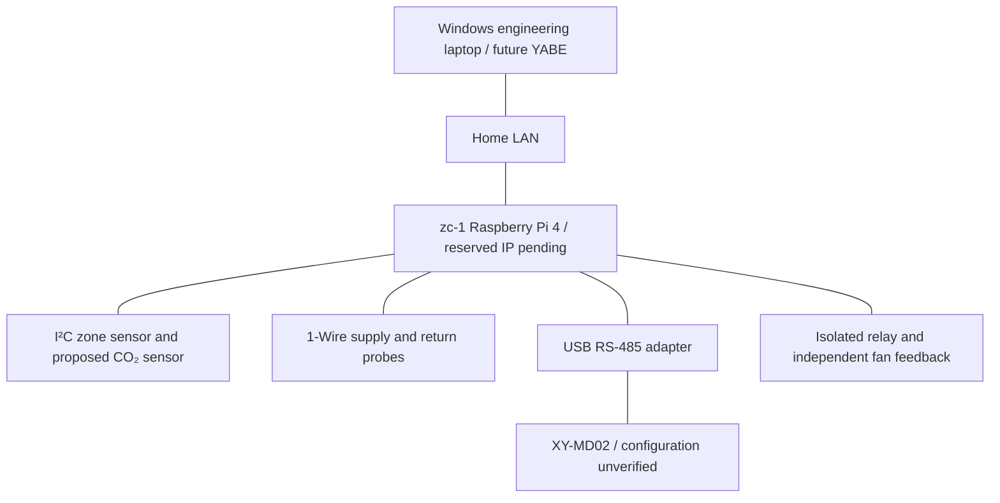

# Proposed network riser

Design only. No IP addresses assigned, bus framing verified, or devices commissioned.

Record IP/subnet/gateway, adapter identity, bus topology, grounding and termination
after the physical survey. Do not expose building protocols directly to the internet.
